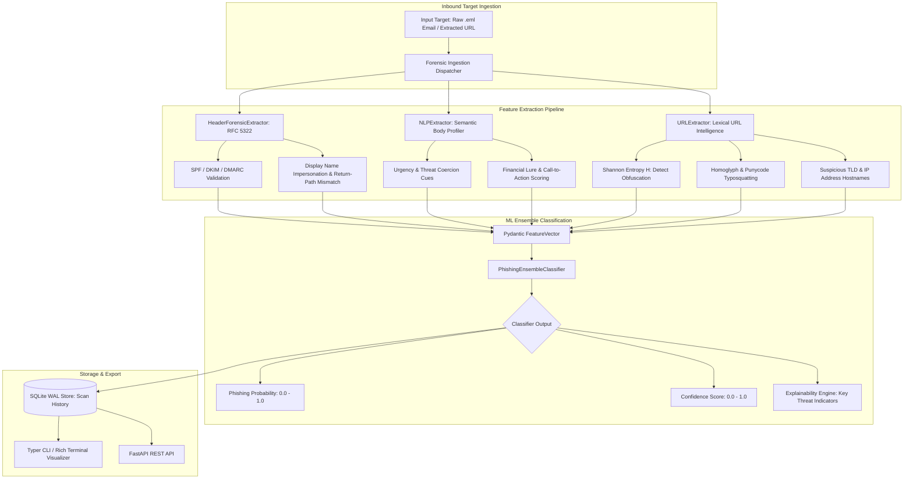

# AI Phishing Detection System (`phish-ai`)

Multi-Modal AI-Assisted Phishing Detection Platform combining RFC 5322 Email Header Forensics, Semantic NLP Psychological Cue Profiling, Lexical URL Intelligence, and Explainable Machine Learning Ensemble Classification.

[](https://github.com/Krish9800/ai-phishing-detection-system/actions)
[](https://opensource.org/licenses/MIT)
[](https://www.python.org/)
[](https://datatracker.ietf.org/doc/html/rfc5322)
[](https://en.wikipedia.org/wiki/Explainable_artificial_intelligence)

---

## Overview & Problem Statement

Phishing remains the primary initial access vector in enterprise cybersecurity breaches. Modern spear-phishing attacks evade traditional signature filters by employing deceptive display names, subtle homoglyph typosquatting domains, legitimate email routing relays, and sophisticated psychological manipulation (urgency cues, financial lures, and legal intimidation).

**AI Phishing Detection System (`phish-ai`)** is a multi-modal forensic analysis and threat classification engine. It evaluates incoming emails and URLs across three orthogonal evidence dimensions: RFC 5322 header forensics (SPF, DKIM, DMARC alignment and spoofing detection), NLP body text semantics (urgency and threat coercion scoring), and lexical URL analysis (Shannon entropy, IP-in-URL, homoglyph character substitution, and suspicious TLD classification). An ensemble classifier produces an objective verdict, a calibrated phishing probability, and transparent threat indicator explanations.

---

## Architecture & Data Flow



---

## Verified Features & Capabilities

- **RFC 5322 Header & Authentication Forensics**:
  - Parses `Authentication-Results` headers for SPF, DKIM, and DMARC alignment (`PASS`, `FAIL`, `NONE`, `SOFTFAIL`).
  - Flags display-name brand impersonation (`Support Team <attacker@suspicious-domain.com>`).
  - Detects sender envelope discrepancies between `From:` and `Return-Path:` headers.
- **Semantic & Psychological NLP Body Profiling**:
  - Quantifies urgency cue density (`immediate action required`, `account suspended within 24h`).
  - Detects financial lures (`unauthorized wire transfer`, `overdue invoice payment`, `gift card`).
  - Flags threat intimidation patterns (`legal action`, `warrant`, `permanent account termination`).
- **Lexical URL Intelligence**:
  - Computes bit-level Shannon entropy ($H(X)$) across URL strings to detect algorithmically generated domains and random query tokens.
  - Detects IP-based hostnames (e.g. `http://192.0.2.1/login.php`) bypassing DNS reputation.
  - Identifies Unicode homoglyphs and Punycode spoofing (e.g. `microsоft.com` with Cyrillic 'о').
  - Flags high-risk top-level domains commonly leveraged in phishing campaigns (`.xyz`, `.top`, `.tk`).
- **Explainable Ensemble Classification**:
  - Yields categorized verdicts: `BENIGN`, `SUSPICIOUS`, or `PHISHING`.
  - Generates top threat indicators explaining the exact attributes driving the classification verdict.
- **Dual Interface**:
  - Interactive terminal CLI (`phish-ai`) with formatted Rich panels and colored indicator tables.
  - Production FastAPI REST API for programmatic scan submission and threat intelligence ingestion.

---

## Technology Stack

- **Core Engine & CLI**: Python 3.12+, Typer, Rich, Pydantic v2
- **REST API**: FastAPI, Uvicorn, Starlette
- **Forensics & NLP**: Standard library `email`, `re`, `urllib.parse`, `math`
- **Database**: SQLite (WAL mode, schema auto-initialization)
- **Quality & Assurance**: Pytest, Pytest-Asyncio, Ruff, Mypy (strict typing)
- **Containerization**: Rootless multi-stage Docker (`UID 10001`)

---

## CLI Reference & Operational Usage

The platform provides the `phish-ai` CLI:

```bash
# 1. Analyze a raw .eml RFC 5322 email file
phish-ai scan-email suspicious_email.eml

# 2. Analyze a suspicious URL for lexical and phishing indicators
phish-ai scan-url "http://198.51.100.33/secure-banking/login.php?token=a8f93e"

# 3. List recent historical scan results
phish-ai scans --limit 20

# 4. Filter historical scans by verdict
phish-ai scans --verdict PHISHING
```

---

## REST API Control Plane

Start the FastAPI daemon:

```bash
uvicorn phish_ai.api.app:app --host 127.0.0.1 --port 8000
```

Interactive OpenAPI specifications are available at `http://127.0.0.1:8000/docs`.

### Primary Endpoints

| Method | Endpoint | Description |
|:-------|:---------|:------------|
| `GET` | `/health` | Health telemetry and classifier status |
| `POST` | `/api/v1/analyze/email` | Submit raw RFC 5322 email text for forensic analysis |
| `POST` | `/api/v1/analyze/url` | Submit URL for lexical intelligence and threat scoring |
| `GET` | `/api/v1/scans` | List historical scan records with verdict filtering |
| `GET` | `/api/v1/scans/{scan_id}` | Retrieve comprehensive scan details and forensic feature vectors |

---

## Installation & Setup

```bash
# Clone the repository
git clone https://github.com/Krish9800/ai-phishing-detection-system.git
cd ai-phishing-detection-system

# Create virtual environment
python3 -m venv .venv
source .venv/bin/activate

# Install dependencies in editable mode
pip install --upgrade pip
pip install -e ".[dev]"
```

---

## Testing & Quality Assurance

Run the test suite:

```bash
# Run pytest test suite
pytest

# Run tests with code coverage metrics
pytest --cov=phish_ai --cov-report=term-missing

# Run code style and lint checks
ruff check .
ruff format --check .

# Run static type verification
mypy src/phish_ai
```

---

## Security Model & Threat Boundaries

Documented in `docs/threat_model.md`:

- **Safe Parser Containment**: Raw email bodies and URLs are processed in memory with strict length caps, mitigating Regular Expression Denial of Service (ReDoS) and memory exhaustion.
- **Zero Outbound Fetching**: The URL analyzer performs passive lexical and cryptographic inspection without executing outbound HTTP connections to untrusted target servers.
- **Unprivileged Runtime**: Docker containers execute as unprivileged user `UID 10001` with drop-capabilities (`cap_drop: ALL`).

---

## Limitations & Known Issues

- **Passive Lexical URL Analysis**: URL inspection is currently performed passively without dynamic DOM rendering or live web crawling to ensure zero-risk execution.
- **Attachment Forensics**: The engine focuses on email headers, text body, and URL links; sandboxed executable attachment extraction is delegated to sandbox tooling.

---

## License & Responsible Use

Distributed under the **MIT License** - see [LICENSE](https://opensource.org/licenses/MIT).

> [!NOTE]
> Designed for email security defense, threat hunting, and automated phishing triage.
